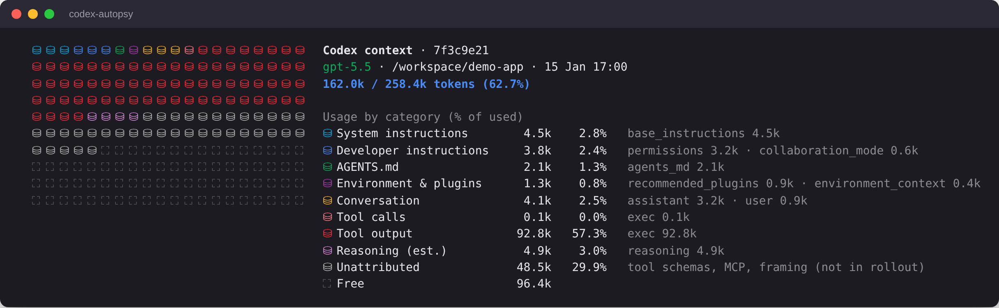
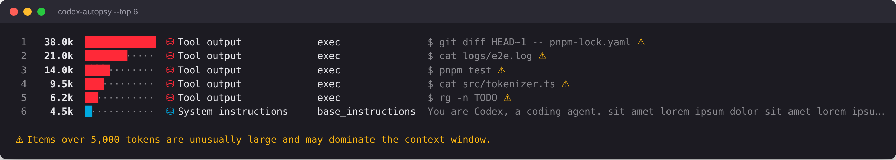
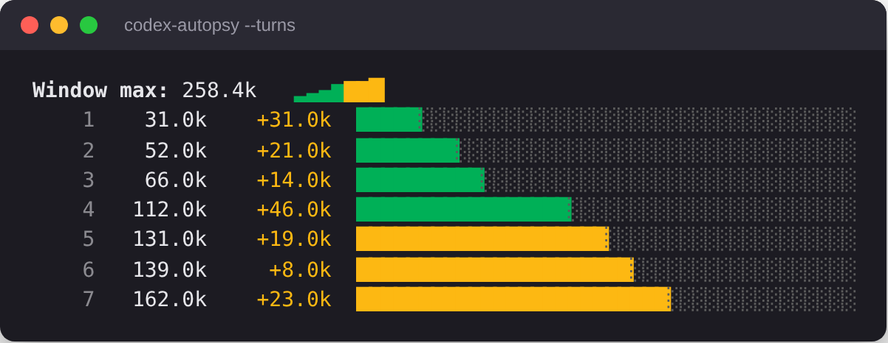

# codex-autopsy

```text
      ___
     /   \
    | x x |   CODEX AUTOPSY
     \_^_/    ● ● ● ● ●
 What killed my context window?
```

> What killed my context window?

A small CLI that shows what's filling your [Codex](https://github.com/openai/codex) context window, broken down by category, for the latest (or any) Codex session.

```bash
npx codex-autopsy                 # latest session in $CODEX_HOME (default ~/.codex)
npx codex-autopsy 01a12f20        # a session by id prefix, or a path to a rollout .jsonl
npx codex-autopsy --list          # recent sessions
npx codex-autopsy --top 10        # the 10 biggest items in the window
npx codex-autopsy --turns         # how the window filled up, turn by turn
npx codex-autopsy --json          # the same breakdown as JSON, for scripts
```



`--top` ranks the biggest single items, so you can see which command or file read filled the window:



`--turns` shows how the window filled up, turn by turn:



The screenshots use a synthetic demo session.

## Colour

Each category has its own colour from the Agoda brand palette. Terminals with 24-bit colour get the exact brand colours; other terminals get the nearest 256-colour or 16-colour match. Colour is off when output is piped, with `--json`, or when `NO_COLOR` is set. Set `FORCE_COLOR=3` to force 24-bit colour, for example when piping into `less -R`.

## What each category means

| Category               | What it counts                                                                    |
| ---------------------- | --------------------------------------------------------------------------------- |
| System instructions    | Base instructions from the session metadata                                       |
| Developer instructions | Developer-role messages (permissions, modes, and similar tags)                    |
| AGENTS.md              | Project agent instructions from world state or legacy user-instructions messages  |
| Environment & plugins  | Tagged user messages such as environment context and plugin lists                 |
| Conversation           | Plain user and assistant messages                                                 |
| Tool calls             | Tool and function call inputs                                                     |
| Tool output            | Tool and function call outputs                                                    |
| Reasoning (est.)       | Reasoning tokens estimated from token-count events (rollout content is encrypted) |
| Unattributed           | Window usage that cannot be tied to rollout content (see below)                   |
| Free                   | Remaining capacity below the model context window                                 |

### Unattributed

Codex does not write tool schemas, MCP definitions, or message framing into the rollout file. The gap between the real context window size and what can be counted from the rollout is shown as **Unattributed** instead of being hidden.

## Privacy

codex-autopsy reads only local files and sends nothing anywhere.

## License

Apache-2.0. See [LICENSE](LICENSE).
